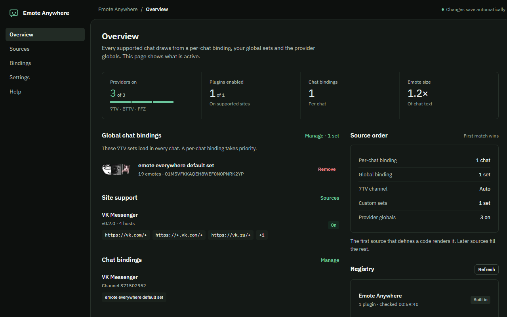

# Emote Anywhere

[](https://github.com/Vijorich/emote-anywhere/actions/workflows/ci.yml)
[](https://github.com/Vijorich/emote-anywhere/releases)

7TV, BTTV and FFZ emotes in any web chat. Site support is not built into the
extension: each chat is described by a declarative JSON plugin, so selectors can be
fixed without shipping a new extension version.



## Status

Public beta (0.2.0). Chrome/Edge (123+) and Firefox MV3. The engine, plugin registry,
settings page, popup and emote picker are implemented; the VK adapter is the first
plugin. Release builds are attached to [GitHub releases](https://github.com/Vijorich/emote-anywhere/releases).

## How it works

Three independent layers:

- **Engine** (`src/engine`) — finds messages, tokenizes text, renders `` emotes,
  survives re-renders and virtualized lists, groups zero-width emotes.
- **Plugin** (`registry/`) — data only: URL patterns, CSS selectors, how to derive a
  channel key, where the composer is. No JavaScript or extension APIs. Provider
  requests are mediated and validated by the extension.
- **Providers** (`src/core/emotes`) — 7TV, BTTV and FFZ clients plus custom
  `code → URL` sets.

Emote size is a setting (slider in settings and popup). The default is **1.2×**
(1.8em at the 1.5em base); the range is 0.5–3.0×.

### Global chat bindings

A global binding is a list of 7TV sets that loads in **every** chat. The default set
is [`emote everywhere default set`](https://7tv.app/emote-sets/01M5VFKKAQEH8WEF0N0PNRK2YP)
(`01M5VFKKAQEH8WEF0N0PNRK2YP`). It is part of the default state and is added to
existing installs on upgrade. Remove it in **Bindings**, or restore it there.

A per-chat binding still wins for the chat it was made for. The full priority is:

1. per-chat binding sets;
2. global binding sets;
3. the site's own 7TV channel (when no per-chat binding exists);
4. enabled custom sets;
5. 7TV, BTTV and FFZ global providers.

The first source that defines a code renders it.

Manage global sets in **Bindings**, or add a per-chat set from the popup while the
chat is open.

The background worker owns all state and emote resolution. Content scripts ask it for
the plugin matching the current URL and for the resolved emote set. There is no
remote code execution: a registry is JSON, not a script.

## Development

```bash
pnpm install
pnpm dev          # Chrome, loads .output/chrome-mv3-dev
pnpm dev:firefox
pnpm test
pnpm typecheck
pnpm build
pnpm preview      # standalone UI preview, no browser extension needed
pnpm dev:page     # mock chat page on :8788
pnpm release:check # public registry, release notes, icons, license, Firefox ID
```

`release:check` verifies the public registry, the GitHub project URL, the permanent
Firefox ID, release notes for the current version, icons and the privacy policy. Run
it before a release; see [BACKLOG.md](BACKLOG.md) for the remaining manual steps.

`pnpm preview` serves the settings and popup UI with a mock extension API at
`http://localhost:5199/options.html` and `/popup.html`; the picker preview is
`http://localhost:5199/picker.html`. It is a development tool; nothing in
`dev/ui` is shipped.

The local default registry is served by:

```bash
pnpm registry     # http://localhost:8787/index.json
```

Copy `.env.example` to `.env` before local development. `.env` points the
development build at the local registry. `.env.production` points at the public
registry, deployed from `registry/` by GitHub Actions to
`https://vijorich.github.io/emote-anywhere/index.json`. The default registry in
the repo can also be loaded as `http://localhost:8787/dev.json` for the mock chat.

`pnpm dev:page` serves `dev/mock-chat.html` at `http://localhost:8788` with a
VK-like image CSP.

## Releases

1. Bump `version` in `package.json`.
2. Add the same version to `CHANGELOG.md`.
3. Push to `main`.

`.github/workflows/release.yml` detects the new version, waits for the public
registry, runs `release:check`, typecheck, tests and both builds, then creates tag
`v<version>` and attaches the Chrome, Firefox and Firefox sources zips to the GitHub
release. If the tag already exists the release is skipped. Store submission steps
are in [`docs/STORE.md`](docs/STORE.md).

The registry itself is deployed by `.github/workflows/pages.yml` whenever
`registry/` changes.

### Try it in Chrome

1. `pnpm dev`
2. `chrome://extensions` → Developer mode → Load unpacked → `.output/chrome-mv3-dev`
3. Open the extension settings. The local registry is fetched on first run.
4. Enable the VK plugin and allow access to `vk.com` / `vk.ru`.
5. Reload the VK tab, open a chat, and check the console for
   `[emote-anywhere]` warnings.

## Adding a chat

1. Copy the `vk` entry from `registry/index.json` or start from the schema in
   [`registry/PLUGIN_API.md`](registry/PLUGIN_API.md).
2. Set `id`, `matches`, `chat.messages`, `chat.text`, `chat.channel` and `composer`.
3. Add the plugin to `registry/index.json`.
4. Reload the registry in the extension settings and enable the plugin.
5. Fix selectors when the site changes; bump `version` so clients pick it up.

## Permissions

- `storage` — settings, plugins, bindings, cache.
- `scripting` — register the content script only for enabled plugin hosts.
- `activeTab` — read the current tab URL from the popup.
- `host_permissions` for `cdn.7tv.app`, `cdn.betterttv.net`,
  `cdn.frankerfacez.com` — background image proxy. BTTV's CDN has no CORS headers.
- `optional_host_permissions: *://*/*` — requested per plugin when you enable it.
  The extension has no access to chat sites until you turn a plugin on. Disabling a
  plugin stops its content script but does not revoke access already granted; revoke
  it in the browser's extension site-access settings if desired.

## Privacy

Emote lookups go directly to 7TV/BTTV/FFZ. The extension sends no telemetry and has
no backend. Chat text never leaves the page. The full policy is in
[`PRIVACY.md`](PRIVACY.md).

## Layout

```
src/
  core/          types, storage, validation, URL matching, emote providers
  engine/        tokenizer, renderer, MutationObserver pipeline
  picker/        shadow-DOM emote picker and text insertion
  background/    state owner, registry sync, content-script registration
  entrypoints/   background, content script, options, popup
  entrypoints/options/views/  one module per settings screen
  ui/            shared theme, components, set lookups
  assets/fonts/  bundled IBM Plex Sans and Plex Mono (SIL OFL)
dev/ui/          standalone settings, popup and picker preview (not shipped)
public/          extension icons
registry/        default JSON registry, deployed to GitHub Pages
scripts/         local registry/dev servers and release check
store/           store screenshots (not shipped)
tests/           engine, core, background, provider, picker and UI tests
.github/         CI, registry deployment and release workflows
```

## Known limits

- Tokens are matched inside one text node. A code split across two elements is not
  matched.
- Shadow-DOM chat surfaces are not traversed.
- Very large custom sets or bindings can hit the extension's state-size guard.
- Zero-width emotes attach to the previous emote only when whitespace separates them.
- A site with a strict `img-src` CSP can block emote images. VK is handled with
  `proxyImages` (background fetch → `data:` URL); other strict sites need the same
  flag in their plugin.
- Firefox MV3 host permission prompts are controlled by the browser; the options
  page requests each plugin's origins explicitly.

## License

MIT. The bundled IBM Plex fonts are under the SIL Open Font License; see
`src/assets/fonts/OFL.txt`.

## VK specifics

The VK plugin (`registry/index.json`, id `vk`) targets the current Convo UI:

- root: `#reforged-root`
- message row: `.ConvoHistory__messageWrapper`
- composer: `.ComposerInput__input` (contenteditable span)
- channel key: `?sel=` or `/im/convo/<id>`
- `proxyImages: true` because VK's `img-src` blocks `cdn.7tv.app` but allows
  `data:`.

The plugin deliberately reads the whole message row and excludes the author header,
time/status, attachments, reactions and buttons. This avoids depending on the exact
internal class of the text bubble.

When VK changes the UI, update `registry/index.json` and bump `version`; users get
the fix on the next registry refresh without an extension update.
