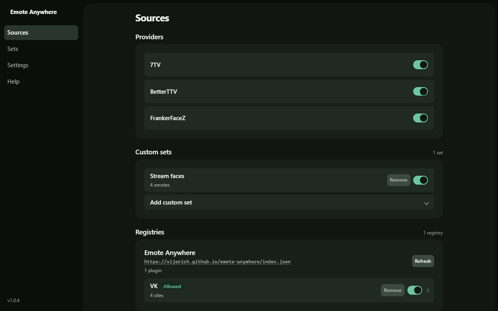

# Emote Anywhere

[](https://github.com/Vijorich/emote-anywhere/actions/workflows/ci.yml)
[](https://github.com/Vijorich/emote-anywhere/releases)
[](LICENSE)

7TV, BetterTTV (BTTV), FrankerFaceZ (FFZ) and Twitch emotes in VK Messenger
and other chats, with a searchable emote picker, per-chat and global emote
sets, persistent offline image caching, and site support that updates from a
plugin registry **without a new extension release**.



## Install

<!-- After store approval, replace this list with store badges and links. -->

- **Chrome / Edge / Brave & other Chromium browsers (123+)**: download
  `emote-anywhere-<version>-chrome.zip` from the latest
  [GitHub release](https://github.com/Vijorich/emote-anywhere/releases), unzip,
  then `chrome://extensions` → Developer mode → Load unpacked. (Store listing
  pending.)
- **Firefox 142+**: download `emote-anywhere-<version>-firefox.zip`, open
  `about:debugging` → This Firefox → Load Temporary Add-on → pick the zip's
  `manifest.json`. A signed store listing is pending; temporary add-ons reset
  on browser restart.

After installing, open the extension settings, enable the **VK Messenger**
plugin and grant access to `vk.com` / `vk.ru` when asked. Nothing is read on
any site until you enable a plugin for it.

## Features

- **7TV, BTTV, FFZ and Twitch global emotes** everywhere a plugin is enabled.
- **Persistent image cache**: proxied images survive a page reload, a service-worker
  restart and a browser restart. The cache is stored in the site's IndexedDB.
- **Blocked-CDN fallbacks**: global 7TV and Twitch metadata can come from public
  mirrors, project snapshots or a self-hosted 7TV proxy; images can fall back to
  `wsrv.nl`. See [docs/7TV_PROXY.md](docs/7TV_PROXY.md).
- **Emote picker**: search a set, navigate by keyboard, insert into the chat
  composer. Shadow-DOM UI, so page styles and strict CSPs do not break it.
- **Chat sets and global sets**: attach different 7TV sets per conversation,
  or load one list of sets in every chat.
- **Adjustable emote size** (0.5–3.0×, default 1.2×).
- **Custom emote sets**: your own `code → URL` pairs, `https:` or
  `data:image/`.
- **Plugin-driven site support**: selectors and URL patterns live in a JSON
  registry, so a site redesign is fixed by a registry update, not an extension
  release.
- **No account, no telemetry, no project backend.** Chat text never leaves the
  page. See [PRIVACY.md](PRIVACY.md).

## How it works

Three independent layers ([full architecture](docs/ARCHITECTURE.md)):

- **Engine** (`src/engine`): finds messages, tokenizes text, renders ``
  emotes, survives re-renders and virtualized lists, groups zero-width emotes.
- **Plugin** (`registry/`): data only. URL patterns, CSS selectors, how to
  derive a channel key, where the composer is. No JavaScript, no extension
  APIs; every field is validated against an allow-list. This is what makes
  remote site support compatible with store rules against remote code.
- **Providers** (`src/core/emotes`): 7TV, BTTV, FFZ and Twitch clients, public
  mirror and snapshot fallbacks, plus custom sets.

The background worker owns all state and emote resolution; content scripts ask
it for the plugin matching the current URL and the resolved emote set.

### Emote priority

When several sources define the same code, the first source wins:

1. chat sets;
2. global sets;
3. the site's own 7TV channel (when no chat set exists);
4. enabled custom sets;
5. 7TV, BTTV, FFZ and Twitch global providers.

Manage global sets in **Sets**, or add a chat set from the popup while the
chat is open. The default global set is
[`emote everywhere default set`](https://7tv.app/emote-sets/01M5VFKKAQEH8WEF0N0PNRK2YP).
Remove or restore it in **Sets**.

## Supported sites

**VK Messenger** is the first plugin (id `vk`, current Convo UI):

- root `#reforged-root`, messages `.ConvoHistory__messageWrapper`,
  composer `.ComposerInput__input` (contenteditable);
- channel key from `?sel=` or `/im/convo/<id>`;
- images are proxied to `data:` URLs because VK's CSP blocks the emote CDNs.

### Adding another chat

Anyone can add one: it is JSON, not code.

1. Copy the `vk` entry from `registry/index.json` or start from the schema in
   [registry/PLUGIN_API.md](registry/PLUGIN_API.md).
2. Set `id`, `matches`, `chat.messages`, `chat.text`, `chat.channel` and
   `composer`.
3. Add the plugin to `registry/index.json` (or serve your own registry and add
   it in the extension's **Sources** screen).
4. Reload the registry in settings and enable the plugin.
5. When the site changes its UI, fix selectors and bump the plugin `version`;
   clients pick it up on the next registry refresh.

## Privacy & permissions

Emote lookups go to 7TV, BTTV, FFZ and Twitch, with public mirror/snapshot
fallbacks when a provider is blocked. The extension sends no telemetry and has
no backend; chat text never leaves the page. Full policy:
[PRIVACY.md](PRIVACY.md).

- `storage`: settings, plugins, chat sets, provider cache (local only, never synced).
- `scripting`: register the content script only for enabled plugin hosts.
- `activeTab`: read the current tab URL from the popup.
- Host access to `cdn.7tv.app`, `cdn.betterttv.net`, `cdn.frankerfacez.com`,
  `static-cdn.jtvnw.net` and `wsrv.nl`: background image proxy and fallback for
  sites whose CSP blocks third-party images (BTTV's CDN sends no CORS headers).
- Optional host access (`*://*/*`) is declared so registry plugins can target
  any chat site, but the extension requests only the origins of plugins you
  enable, from a click. Custom image hosts get their own optional origin grant
  when you add a set. The extension does not read chat messages until you
  enable a plugin. Disabling a plugin stops its content script but does not
  revoke access already granted; revoke it in the browser's extension
  site-access settings if desired.

## Development

Requires Node 22+ and [pnpm](https://pnpm.io).

```bash
pnpm install
pnpm dev            # Chrome, loads .output/chrome-mv3-dev
pnpm dev:firefox    # Firefox
pnpm test           # 193 unit and integration tests
pnpm typecheck
pnpm build          # production build
pnpm preview        # standalone UI preview at http://localhost:5199 (no browser needed)
pnpm dev:page       # mock chat page on :8788
pnpm registry       # local default registry on :8787
pnpm snapshot       # refresh registry/emotes snapshots
pnpm release:check  # release readiness gate
```

Copy `.env.example` to `.env` first; it points the dev build at the local
registry. `.env.production` points at the public registry deployed from
`registry/` to
`https://vijorich.github.io/emote-anywhere/index.json` by GitHub Actions.

`pnpm dev:page` serves `dev/mock-chat.html` at `http://localhost:8788` with a
VK-like image CSP for testing `proxyImages`. The visual design system and its
rationale are in [DESIGN.md](DESIGN.md).

### Project layout

```
src/
  core/          types, storage, validation, URL matching, emote providers
  engine/        tokenizer, renderer, MutationObserver pipeline
  picker/        shadow-DOM emote picker and text insertion
  background/    state owner, registry sync, content-script registration
  entrypoints/   background, content script, options, popup
  ui/            shared theme, components, set lookups
dev/             UI preview harness and mock chat (never shipped)
public/          extension icons
registry/        default JSON registry, deployed to GitHub Pages
scripts/         local servers and the release check
store/           store screenshots and listing assets (never shipped)
tests/           vitest suites
```

### Releases

Versions and changelog entries are generated from the commit history; nobody
writes them by hand. Commit subjects follow
[Conventional Commits](https://www.conventionalcommits.org/) and the version
follows [Semantic Versioning](https://semver.org/):

| Commit subject | Version bump |
| --- | --- |
| `fix: ...` | patch (`1.0.1`) |
| `feat: ...` | minor (`1.1.0`) |
| `fix!:` / `feat!:` or a `BREAKING CHANGE:` footer | major (`2.0.0`) |
| `docs:`, `ci:`, `chore:`, `test:`, `refactor:` | none |

After changes land on `main`, [release-please](https://github.com/googleapis/release-please)
opens a release pull request with the proposed `package.json` version and the
`CHANGELOG.md` entry. Merging that PR publishes the release: the `v<version>`
tag and the GitHub release are created, then `.github/workflows/release.yml`
waits for the public registry, runs `release:check`, typecheck, tests and both
builds, and attaches the Chrome zip, Firefox zip and Firefox sources zip to
the release. Never bump the version, edit `CHANGELOG.md` or create a tag by
hand; fix the commit subject instead. CI rejects subjects that break the
format (`pnpm commits:check origin/main..HEAD` checks locally). Store
submission steps: [docs/STORE.md](docs/STORE.md).

## Contributing, support, security

- **Bug reports and feature requests:**
  [open an issue](https://github.com/Vijorich/emote-anywhere/issues).
  Selector fixes for the VK plugin are the most valuable contributions; see
  [Adding another chat](#adding-another-chat).
- **Contributing guide:** [CONTRIBUTING.md](CONTRIBUTING.md).
- **Found a security issue:** see [SECURITY.md](SECURITY.md). Do not open a
  public issue for it.
- **Backlog and known limits:** [BACKLOG.md](BACKLOG.md).

## License

[MIT](LICENSE) © Viktor Antonov. Emote data and images belong to 7TV,
BetterTTV and FrankerFaceZ and their respective creators.
